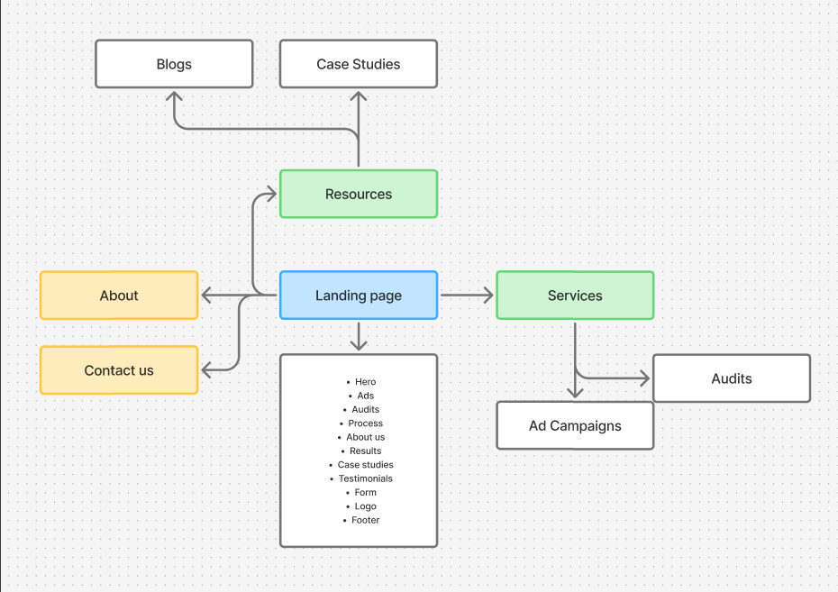

# Site structure

Source: sitemap from the project owner (`sitemap.png`, below).

## Sitemap

- **Landing page**
  - About
  - Contact us
  - Resources
    - Blogs
    - Case Studies
  - Services
    - Ad Campaigns
    - Audits

## Landing page sections

Build the landing page in exactly this order:

1. Hero
2. Ads
3. Audits
4. Process
5. About us
6. Results
7. Case studies
8. Testimonials
9. Form
10. Logo
11. Footer

## Scope of the stack comparison

Only the landing page is part of the stack comparison: its sections are the
ones rebuilt across frameworks and animation libraries in this lab.

The other pages (About, Contact us, Resources, Blogs, Case Studies, Services,
Ad Campaigns, Audits) will be mostly static, so they will not be built with
different tools.
